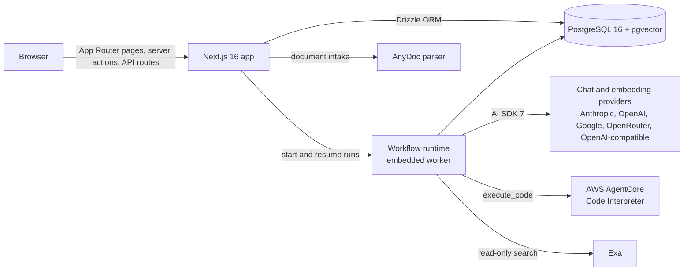

<p align="center">
  
</p>

<h1 align="center">Atlas LMS</h1>

<p align="center">
  A learning management system rebuilt around teacher-governed AI.<br />
  Professors program the AI their students learn with. Students work inside it. The learning itself, not just the submission, becomes visible.
</p>

<p align="center">
  <a href="https://github.com/Prashant002-1/Atlas-LMS/actions/workflows/ci.yml"></a>
  <a href="LICENSE"></a>
  
  
</p>

---

Atlas started as a startup product and is now published as an open-source
portfolio project under the MIT license. It is a complete, runnable system:
a multi-tenant LMS, a professor-facing course agent with typed tools, a
governed student work session that is itself the assessment, and a grading
pipeline that scores the reasoning journey against verified transcript
evidence. Fork it, study it, or build on it.

## What it does

**For professors.** A full course record: modules, pages, materials,
assignments, announcements, calendar, roster, gradebook, and course setup.
Atlas, the course agent, sits beside that record. It can read and act on the
LMS through typed, tenant-scoped tools, but every course-changing write lands
as a proposal the professor reviews and applies.

**For students.** The same course, seen from the other side, plus governed
work sessions. An AI assignment opens by stating what doing well looks like.
The student thinks through the problem with the course agent inside a contract
the professor wrote: hint depth, boundaries, and a rubric that grades the
journey rather than the final answer.

**For the record.** When a session is submitted, the rubric reads the
transcript. Each criterion is scored from verbatim student quotes that are
string-verified against the stored turns. The professor sees the evidence,
finalizes the grade, and reads a class-wide rollup that says which concept the
class actually struggled with.

### Capabilities at a glance

| Area | What is implemented |
| --- | --- |
| Course record | Organizations, terms, courses, enrollments, modules, pages, materials, assignments, announcements, quizzes, practice sets, gradebook |
| Professor agent | Durable planning chats, versioned course-agent configuration, reviewed skills in `.atlas/`, read tools, draft tools, and propose-then-apply write actions |
| Student sessions | Streaming work sessions with a typed artifact panel, course-record side notes, steering of a running response, deadline conclusion |
| Grading | Per-criterion evidence extraction, exact-match quote verification, deterministic level-to-score mapping, draft reports until finalized, class rollups |
| Personal agents | A per-student Atlas with durable memory, bounded by platform, university, and course policy |
| Materials | Upload, link, and package intake; AnyDoc parsing to Markdown; pgvector embeddings; private originals |
| Code execution | Python, JavaScript, and TypeScript in disposable AWS AgentCore Code Interpreter sessions, outside the web process |
| Voice | Composer transcription through Gemini, separate from the chat model |
| Web search | One bounded, read-only Exa tool when server policy permits |
| Runtime | Durable, resumable agent runs on the Workflow runtime backed by PostgreSQL |

## Architecture



The full overview, including the request flow for a session turn, the grading
pipeline, and the security boundaries, is in
[`docs/architecture.md`](docs/architecture.md). Design decisions are recorded
as ADRs in [`docs/adr/`](docs/adr/README.md).

## Tech stack

| Layer | Choice |
| --- | --- |
| Framework | Next.js 16 (App Router, server actions, standalone output), React 19, TypeScript |
| Styling | Tailwind CSS 4, a small design-token system in `app/globals.css`, Geist fonts |
| Data | PostgreSQL 16 with pgvector, Drizzle ORM, reviewed SQL migrations with a release ledger |
| AI | Vercel AI SDK 7 with typed data parts and tool calls; provider-agnostic model resolution |
| Durable runs | `workflow` with `@workflow/world-postgres` |
| Auth | Auth.js (credentials), per-deployment login allowlist, login aliases |
| Documents | `@firecrawl/anydoc` for PDF, Office, and package parsing |
| Execution | `@aws-sdk/client-bedrock-agentcore` |
| Delivery | Docker multi-stage image, GitHub Actions CI, CloudFormation template for AWS |

## Getting started

Requirements: Node.js 24 or newer and Docker.

```bash
docker compose up -d db
npm install
cp .env.example .env.local
npm run db:push -- --force
npm run db:upgrade -- --allow-destructive
npm run workflow:bootstrap
npm run db:seed
npm run local:check
npm run dev
```

Open [http://localhost:3000](http://localhost:3000). The seeded demo tenant has
two accounts, both with the password `atlas1234`:

| Role | Email |
| --- | --- |
| Instructor | `instructor@demo.edu` |
| Student | `student@demo.edu` |

The seed is a deliberately course-sized record: one fourteen-week economics
course with real documents, a graded history, current work, and a completed
assessed session. The people in it are fictional.

For an existing local database, skip the initializer and run the managed
upgrade path instead:

```bash
docker compose up -d db
npm run db:upgrade
npm run workflow:bootstrap
npm run dev
```

### Configuration

`.env.example` documents every variable. The important groups:

- **Database.** `DATABASE_URL` and `WORKFLOW_POSTGRES_URL`. Local development
  shares one Compose database; production should separate them.
- **Auth.** `AUTH_SECRET`, `AUTH_URL`, and an optional
  `ATLAS_ALLOWED_LOGIN_EMAILS` allowlist for a private deployment.
- **Chat and structured models.** `ATLAS_CHAT_PROVIDER` plus the matching
  provider key. Core records and navigation work with no provider configured;
  agent features need one.
- **Embeddings.** `ATLAS_EMBEDDING_PROVIDER` and model, used by material
  search.
- **Optional services.** Gemini for voice transcription, Exa for web search,
  AWS credentials for AgentCore code execution, Canvas for import.

Provider credentials are server environment only. Teacher and student
surfaces never read, display, or override them.

## Verification

```bash
npm run verify        # typecheck, lint, unit tests, production build
npm run smoke         # signed-in route smoke test; needs the dev server running
npm run smoke:workflow
npm run db:check      # read-only schema and release-ledger check
```

CI runs the same gate on every pull request against a disposable PostgreSQL
database, audits production dependencies, and builds the container.

## Deployment

- `Dockerfile` builds a standalone Next.js image that runs the web server and
  the embedded Workflow worker in one process. `docker compose --profile full`
  runs it beside the database.
- [`infra/aws/`](infra/aws/README.md) holds a CloudFormation template and
  scripts for a small single-host AWS deployment: one Graviton EC2 host behind
  a static address, private RDS PostgreSQL, ECR, Secrets Manager, CloudWatch
  alarms, and a cost budget. Parameters are placeholders; supply your own
  domain and alert recipient.
- [`docs/deployment/`](docs/deployment/) covers AgentCore setup and dependency
  maintenance.

## Repository layout

```
app/            Next.js routes: /teach, /student, /sign-in, /api
components/     UI by surface: atlas, cockpit, session, teach, student, ui
lib/agent/      Professor operator, session runtime, grading, rollups, proposals
lib/ai/         Provider registry, platform model resolution, embeddings, transcription
lib/code-execution/  AgentCore session lifecycle and contracts
lib/course/     Materials, documents, policies
lib/db/         Drizzle schema, seed, fixtures (the ECON-241 demo world)
lib/instructor/ lib/student/ lib/workspace/   Server-side view models and actions
workflows/      Durable agent-session workflow definitions
.atlas/         Reviewed authoring layer for the professor agent (skills, guardrails)
drizzle/        SQL migrations
scripts/        Release, readiness, smoke, and maintenance scripts
docs/           Thesis, architecture, ADRs, agent tool contracts, design system
infra/aws/      CloudFormation template and deployment scripts
```

## Documentation

Start at [`docs/README.md`](docs/README.md). Highlights:

- [`docs/Vision.md`](docs/Vision.md), the thesis behind the product.
- [`docs/architecture.md`](docs/architecture.md), the system overview.
- [`docs/adr/`](docs/adr/README.md), fourteen architecture decision records.
- [`docs/agent-tools/`](docs/agent-tools/README.md), the typed tool contracts
  the professor agent uses.
- [`docs/DesignSystem.md`](docs/DesignSystem.md) and
  [`docs/Brand.md`](docs/Brand.md), the interface language.

## Project status

Atlas is complete as a v0: the loop from professor configuration, through a
student session, to evidence-verified grading and class insight runs end to
end on real data. It is published as a portfolio project and maintained on a
best-effort basis. There is no hosted service. A companion standalone
"AI Assignments" product was scoped in
[ADR-0021](docs/adr/0021-standalone-ai-assignments-product-boundary.md) and
lives outside this repository; Atlas only ships an opt-in client for it.

## Contributing

See [CONTRIBUTING.md](CONTRIBUTING.md). Security reports go through
[SECURITY.md](SECURITY.md).

## License

[MIT](LICENSE). Third-party notices are in
[THIRD_PARTY_NOTICES.md](THIRD_PARTY_NOTICES.md).
