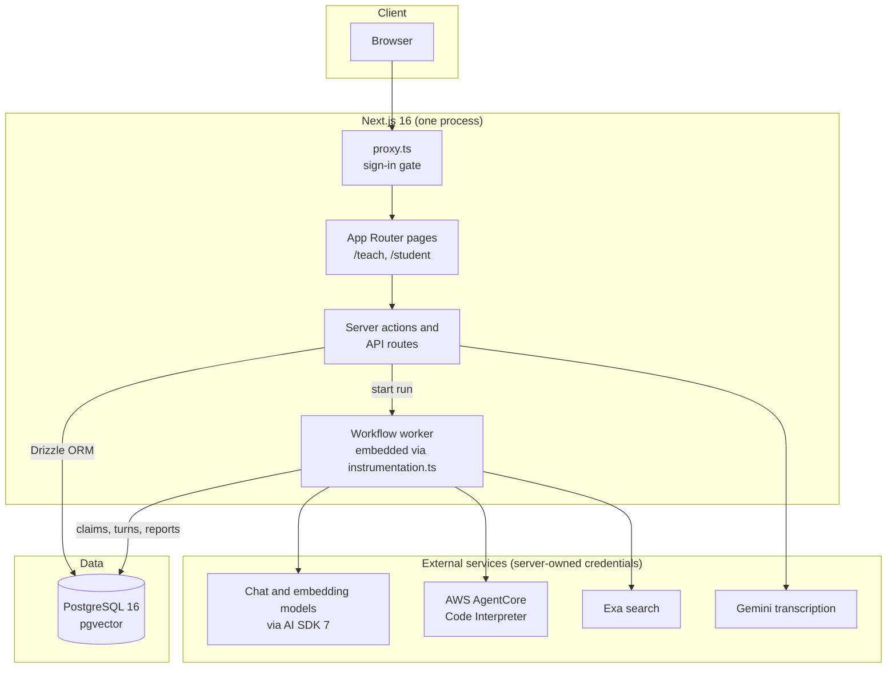

# Atlas architecture

This is the system overview. The decisions behind it are in
[`adr/`](adr/README.md); the grading pipeline research is in
[`v0/architecture.md`](v0/architecture.md).

## One picture

Atlas is signed-in software. Only `/sign-in`, `/sign-up`, `/api/auth/*`, and
`/api/health` are reachable without an Auth.js session (`proxy.ts`). Every
other page, action, and route resolves the organization and course scope on
the server from the signed-in user.

## Layers

| Layer | Where | Role |
| --- | --- | --- |
| Routes and UI | `app/`, `components/` | Record-first pages for professors (`/teach`) and students (`/student`). Server components read view models; client components handle streaming and forms. |
| View models and actions | `lib/instructor/`, `lib/student/`, `lib/workspace/`, `lib/course/` | Scoped reads and validated mutations for the course record. |
| Agent runtime | `lib/agent/`, `workflows/agent-session.ts` | Professor operator, student session runtime, personal student Atlas, grading, rollups, proposals, steering, side notes. |
| Agent authoring | `.atlas/` | Reviewed, non-executable authoring files for the professor agent: role, guardrails, and on-demand skills loaded through a bounded `load_skill` tool. |
| Model access | `lib/ai/` | Provider registry, server-only platform model resolution, embeddings, transcription. |
| Code execution | `lib/code-execution/` | AgentCore session lifecycle, bounded inputs and outputs, artifact persistence. |
| Data | `lib/db/`, `drizzle/` | Drizzle schema, reviewed SQL migrations with a release ledger, seed and fixtures. |

## Three agents, one record

Atlas has three agent profiles (ADR-0011, ADR-0016). They share tools and
context code but differ in scope and authority.

1. **Professor Atlas** is the course-wide operator (ADR-0013). It reads the
   LMS through typed read tools, drafts through draft tools, and changes the
   course only through proposals. Course-agent identity and teaching behavior
   are append-only, versioned configuration written through conversation and
   compiled into student sessions below fixed platform rules (ADR-0014).
2. **The assessed session agent** runs a student's governed work session for
   one assignment (ADR-0015). It is compiled from the professor's contract,
   the current course agent configuration, and the course record. It receives
   `execute_code` by default and the bounded web search when policy permits.
3. **The student's personal Atlas** is a per-student agent with durable
   memory, bounded by the policy ladder: platform, then university, then
   every applicable course policy (ADR-0016).

The professor remains the court of appeal. Nothing an agent produces becomes
a grade, a post, or a published object without a human applying it.

## A session turn, end to end

1. The route under `/api/session/[assignmentId]` authenticates, resolves the
   session, and persists the student's turn **before** any generation starts.
2. It claims a run and starts the durable workflow in
   `workflows/agent-session.ts`. The Workflow runtime stores run state in
   PostgreSQL, so a refresh or a crash does not lose the turn.
3. `lib/agent/session-runtime.ts` rebuilds the course context and course-agent
   configuration for that turn, compiles the instructions below fixed
   assessed-session rules, and streams with AI SDK 7. Typed `data-*` parts
   carry the artifact panel and side-note cards; tool parts carry code
   execution and search.
4. The client subscribes to `/api/agent-runs/[runId]/stream`. A steering
   request (`/api/atlas/steer`, ADR-0017) can redirect a running response.
5. The completed assistant turn and artifact snapshots are persisted. Rows,
   not the stream, are the source of truth for refresh, submission, and
   grading.

Professor planning turns (`/api/atlas/planning`) and personal Atlas turns
(`/api/atlas/student`) follow the same shape with their own runtimes.

## Grading: the rubric reads the transcript

When a session is submitted, `lib/agent/grading.ts` runs per criterion:

1. Normalize the transcript into stable turns with speaker roles.
2. Extract candidate quotes from **student** turns only.
3. Verify every quote by exact string match against the stored turn. A quote
   that fails verification is re-extracted once, then dropped. No unverified
   quote reaches a score or a screen.
4. Judge the level from the criterion's own descriptors, the verified evidence
   with surrounding context, and the frozen artifact.
5. Map the level to points deterministically. The model never picks a number.
6. Store a **draft** journey report. The professor finalizes it; finalization
   is the only audited gradebook writer.
7. Recompute the class rollup as deterministic aggregation over stored scores.
   Narration sits on top; it never invents statistics.

A model or transport failure aborts the run without storing a report. A
grading outage must never grade a student down.

## Proposals and apply

Every course-changing write from an agent is a `changeProposals` row. The
professor reviews it inline (ADR-0019) and applies or dismisses it.
`lib/agent/apply.ts` performs the write as one transaction. This is the single
door between a draft and the live course, for agents and for forms alike.

## Documents and search

Material intake (`lib/course/`) stores the exact uploaded bytes as a private
original, parses them with AnyDoc into canonical Markdown, chunks and embeds
the text with the configured embedding provider, and stores vectors in
pgvector. The seed runs the same pipeline against the checked-in asset pack.
See [`course-materials/ingestion-contract.md`](course-materials/ingestion-contract.md).

## Code execution boundary

Assessed sessions can run Python, JavaScript, and TypeScript. Execution
happens in a disposable AWS AgentCore Code Interpreter session with a bounded
workspace lifetime (ADR-0020). Atlas stages only bounded text inputs, copies
back only declared outputs, persists terminal results and authorized
artifacts, and stops the workspace when the session submits. Model-authored
code never runs in the web or Workflow process, and the sandbox receives no
provider, database, or host credentials.

## Security boundaries

- **Tenancy.** Every table that holds course data carries the organization,
  and queries are scoped from the authenticated user. Client input never
  chooses a tenant.
- **Credentials.** Provider keys, endpoints, and model ids are resolved from
  server environment only (`lib/ai/platform-model.ts`). No course actor can
  read or set them.
- **Login.** Auth.js credentials with hashed passwords; an optional
  per-deployment email allowlist; login aliases that resolve to a canonical
  identity without exposing it.
- **Agents.** Tool authority comes from the runtime, not from configuration
  text. A course-agent configuration changes teaching behavior only; it cannot
  grant tools, data, or permissions.
- **Writes.** Propose, then approve. See above.
- **Execution.** Outside the process, bounded, disposable. See above.

## Deployment shape

One container runs the Next.js standalone server and the embedded Workflow
worker. PostgreSQL is the only stateful dependency; the application and
Workflow databases can be the same instance locally and separate in
production. The AWS template in [`infra/aws/`](../infra/aws/README.md)
deploys that shape on a single Graviton host with a private RDS instance.
