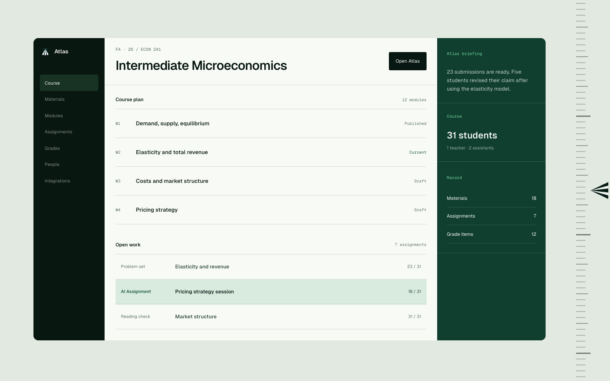

# Launch dashboard visual reference

This reference captures the dashboard illustration in the sibling
`Atlas-Launch-Page` working tree on 2026-09-03. It is a palette and surface
reference for the authenticated Atlas-LMS dashboard. It is not a replacement
layout, navigation model, or data model.

## Source snapshot

- Repository: `/Users/prashantshah/Desktop/Prashant/Prashant Gallery/Code/Atlas-Launch-Page`
- Branch: `main`
- HEAD: `8d35a8c254de6a860dfea8279df5ebd6fefe1154`
- Working-tree source: `index.html` and `product.css`
- `index.html` SHA-256: `1fad5a18c8efab348ee88fc905181832796375802f7ebceae6ec7164c62f0325`
- `product.css` SHA-256: `9482f1d0221f9a33b04f2f065d8d0f59b08ff6a672733ab28dda76afc5b52f85`
- Capture viewport: 1440 by 900 CSS pixels
- Screenshot SHA-256: `52f219dc207fa2e12cb175e45dc835f966d9e07b90c8f79b3aea1dc80b1ab2c4`

The source repository was clean when captured. The hashes above identify the
exact source files used to render the image.

## Transferable treatment

The illustration uses three clear surface roles:

1. A deep hunter-green navigation surface (`#091711`) with quiet inactive
   navigation and a restrained green active state.
2. A calm, near-white course workspace (`#f8faf6`) with deep ink (`#071712`)
   and hairline separators.
3. A dedicated Atlas rail in pine (`#103f30`), with mint labels and light
   text. AI Assignment rows use a pale green wash (`#d9eadf`) inside the white
   workspace.

## Atlas-LMS boundary

- Preserve every current sidebar item, icon, label, section, active state,
  account control, and collapse or expand behavior.
- Preserve the dashboard content, records, links, and responsive hierarchy.
- Apply the pine treatment to the existing Atlas briefing and course-assistant
  area. Do not turn the prototype's illustrative course and record blocks into
  new Atlas-LMS dashboard content.
- Use the composition as a role map: dark navigation, white records, pine
  Atlas surfaces, and pale green AI-assignment emphasis.
